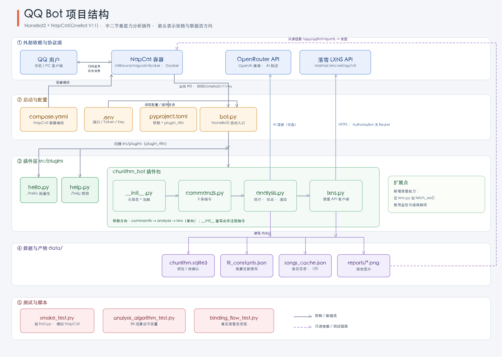
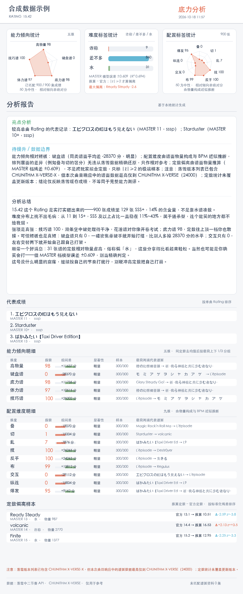

# QQ Bot（NoneBot2 + NapCat）

基于 NoneBot2 与 `nonebot-adapter-onebot`，通过 OneBot V11 反向 WebSocket 连接 NapCat。

当前内置插件：**中二节奏（CHUNITHM）底力分析** —— 绑定落雪（LXNS）玩家后，生成包含能力倾向、配置维度、定数偏离与锐评总结的图片报告。





## 本地准备

需要 Python 3.10+ 和 [uv](https://docs.astral.sh/uv/)。项目使用 Python 3.12 运行。

```bash
cp .env.example .env
```

编辑 `.env`，把 `ONEBOT_ACCESS_TOKEN` 换成随机长字符串。然后安装依赖并启动：

```bash
uv sync
uv run python bot.py
```

服务默认监听 `0.0.0.0:8080`。首次启动后，NoneBot 的 OneBot V11 WebSocket 服务地址为：

```text
ws://<NoneBot所在主机>:8080/onebot/v11/ws
```

## NapCat 部署与连接

项目提供了 [`compose.yaml`](compose.yaml)，NapCat 以 Docker 容器运行，并自动配置 OneBot V11 反向 WebSocket 回连宿主机上的 NoneBot：

```bash
docker compose up -d napcat
docker compose logs -f napcat
```

浏览器打开 `http://127.0.0.1:6099/webui`，使用 `.env` 中的 `NAPCAT_WEBUI_TOKEN` 登录并完成 QQ 扫码登录。WebUI 和 NapCat 的持久化数据分别映射到 `./data/qq`、`./data/napcat-config`、`./data/napcat-plugins`。`.env` 已被 Git 忽略，请不要提交访问令牌。

映射端口：

- `127.0.0.1:6099`：NapCat WebUI，仅本机访问
- `127.0.0.1:3001`：NapCat WebSocket，仅本机访问
- `8080`：NoneBot HTTP/WebSocket 服务；NapCat 容器通过 `host.docker.internal` 回连

首次启动用到的 `data/napcat-config/onebot11.json` 已预置反向 WebSocket 地址和 `.env` 中的 `ONEBOT_ACCESS_TOKEN`。NapCat WebUI token 与 OneBot Access Token 是两个独立凭据；`data/` 已加入 Git 忽略，配置含有访问令牌，不要提交。若已有 NapCat 持久化配置，已有配置会优先；修改 URL 或 token 后，需要在 WebUI 的“网络配置”中同步更新。

需要先安装并启动 Docker Desktop，再启动 NoneBot 和 NapCat。NapCat 官方 Docker 镜像面向 Linux amd64/arm64；在 Apple Silicon/macOS 上由 Docker Desktop 提供 Linux 容器环境。官方参考：[NapCat-Docker](https://github.com/NapNeko/NapCat-Docker) 与 [NapCat NoneBot 接入说明](https://doc.napneko.icu/use/integration)。

macOS 上双击 `启动NapCat.command` 会自动等待 Docker 就绪后启动容器，双击 `启动NoneBot.command` 启动机器人本体。

### QQ 登录态与重新扫码

`.env` 里的 `QQ_ACCOUNT` 是机器人 QQ 号。容器重建时 NapCat 用它做「快速登录」，直接复用 `./data/qq` 里已保存的登录态，正常情况下不用重新扫码；留空则每次都走二维码登录。

但要注意：**重启 NapCat 容器可能会让登录态失效**（实测遇到过 `快速登录错误：登录态已失效`）。容器启动时如果没登录上，NapCat 会在终端打印二维码，并每 1~2 分钟自动刷新一次。

登录失效时双击 `显示登录二维码.command`：它会把当前二维码导出到 `outputs/napcat-login-qrcode.png` 并用预览打开，同时打印解码 URL。二维码过期时脚本会问你要不要重启容器重新生成（重启会短暂断开机器人，已登录的话必须重新扫码，所以机器人正常在线时不要运行）。

## 插件

插件目录为 `src/plugins/`：

```text
src/plugins/
├── chunithm_bot/          中二节奏底力分析（插件包）
│   ├── __init__.py        插件入口：元信息 + 子模块加载
│   ├── lxns.py            落雪 API 客户端：URL、鉴权、错误翻译、曲目缓存
│   ├── analysis.py        数据层：绑定库、统计、AI 简报、报告渲染
│   └── commands.py        指令层：/中二绑定系列、/底力分析
├── help.py                /help 帮助
└── hello.py               /hello 连通性测试
```

依赖方向单向：`commands → analysis → lxns`。要给机器人加新的落雪能力（查趋势、查单曲排名等），在 `lxns.py` 里加一个 `async def fetch_xxx()` 即可，URL、鉴权和错误翻译都复用现成的基础层；分析逻辑再在 `analysis.py` 里组合。

### 中二节奏底力分析

群聊和私聊都可以使用，绑定按发送者 QQ 区分：

- `/中二绑定 好友码`：按好友码查询落雪玩家资料并展示确认信息；在 10 分钟内发送 `/中二绑定确认` 完成绑定。只认好友码，不做 QQ 关联核对——落雪不保证登记了用户的 QQ，硬核对会把没绑 QQ 的玩家直接挡在门外。
- `/中二绑定状态`：查询绑定状态。
- `/中二解绑`：删除自己的绑定。
- `/底力分析`：读取 Best / Selection / New / Recent 成绩，生成仿照示例布局的分析图片，含能力倾向统计、难度标签统计、配置标签统计和锐评总结。别名 `/中二底力分析`、`/chunithm底力分析`。

群聊里好友码和成绩报告对同群成员可见，`/help` 中已提示，介意时请私聊查询。

在项目 `.env` 中配置：

- `LXNS_DEV_TOKEN`：落雪开发者 API 密钥，**必须原样填写，不要加 `Bearer ` 前缀**（落雪的鉴权方式是 `Authorization: <密钥>`，加了前缀会被判 401 unauthorized）。不要提供落雪密码。
- `OPENROUTER_API_KEY`：可选，AI 总结用；留空仍能生成统计报告和本地规则总结。这个走 OpenAI 兼容协议，**需要 `Bearer ` 前缀**，别和上面的落雪密钥混了。
- `OPENROUTER_MODEL`：默认为 `google/gemma-4-31b-it:free`。按 OpenRouter 当前官方说明，免费模型默认每天总计 50 次请求；额度和可用模型可能调整。模型不可用时自动回退为本地总结。用于 AI 总结的少量结构化成绩信息会发送到 OpenRouter。

### 落雪 API 密钥与权限

落雪（LXNS）的密钥和权限分几步，报错时要先分清是哪种：

| 报错 | 含义 | 怎么办 |
| --- | --- | --- |
| 401 unauthorized | 密钥本身被拒 | 检查是不是误加了 `Bearer ` 前缀；确认用的是「开发者 API 密钥」而不是「个人 API 密钥」 |
| 403 权限不足 | 密钥有效但没权限 | 需要 `allow_third_party_fetch_player`（玩家资料）和 `allow_third_party_fetch_scores`（成绩），在被查询玩家的落雪账号设置里开启第三方读取授权 |
| 400 invalid friend code | 密钥有效，好友码格式不对 | 落雪好友码是 15 位数字，核对位数 |
| 404 player not found | 密钥有效，好友码没有对应玩家 | 核对好友码；对方也可能还没在查分器同步过成绩 |
| 404 user not found | 密钥有效，但这个 QQ 没登记在落雪 | 只有按 QQ 查（`/player/qq/{qq}`）才会遇到。插件绑定流程不使用该接口 |
| 403 allow third party fetch history is disabled | 密钥有效，但玩家没开历史读取授权 | 只有 `/player/{friend_code}/trend`（成绩趋势）需要 `allow_third_party_fetch_history`；插件不使用该接口 |

密钥相关入口：

- 开发者文档：<https://maimai.lxns.net/docs/developer-guide>
- 中二节奏接口文档：<https://maimai.lxns.net/docs/api/chunithm>
- 申请成为开发者（需先完成邮箱验证）：<https://maimai.lxns.net/developer/apply>
- 开发者面板：<https://maimai.lxns.net/developer>
- 账号详情（生成个人 API 密钥）：<https://maimai.lxns.net/user/profile>

注意「开发者 API 密钥」和「个人 API 密钥」不能混用，请求头也不同（开发者用 `Authorization`，个人用 `X-User-Token`）。文档明确说明开发者 API 拿不到玩家的**全部**完整成绩，但 `/player/{friend_code}/scores` 可以拿到缓存的所有最佳成绩。本插件同时读三个成绩接口并按「曲目+难度」去重取高分：`/bests`（Best30/Selection10/New20，**带具体分数和单曲 Rating**）、`/scores`（覆盖率最高，但**只有评级没有分数**）、`/recents`（最近 50 次，带分数）。`/scores` 和 `/recents` 失败时静默降级，不影响报告。

报告从落雪曲目接口读取曲目、难度和官方定数，每 12 小时缓存。当前测试到的落雪响应中，版本目录虽已列出 X-VERSE-X（24500），但谱面数据最高仅到 X-VERSE（24000）；报告会显示该数据版本警告，不把旧谱面数据冒充为 X-VERSE-X。之后需要更新落雪曲目数据或提供经核验的 X-VERSE-X 定数表。

### 配置维度、能力倾向与定数偏离估算

报告里的这三块都由**谱面真实物量数据**驱动，不需要外部谱面数据库——落雪 `GET /chunithm/song/list?notes=true` 已经给每张谱面返回完整的 `notes`（`total/tap/hold/slide/air/flick`），实测覆盖 5758/5758 张谱面、六个字段无缺失。

**配置标签统计（九维，右栏雷达图 + 下方明细表）**：叠 / 切 / 技 / 乱 / 反手 / 布 / 交互 / 纵连 / 爆发。这几个词来自中二社区对谱面「配置」的称呼，其中叠（Jack）/ 切（Stream）/ 乱（Speed）/ 技（Tech）是散点谱的四大键型，其余是常见配置特征。

**能力倾向（五维）**：高物量 / 键盘谱 / 底力谱 / 体力谱 / 技巧谱。

两套维度共用同一套算法：「同定数档内去均值 → 按该维载荷切上下各 1/3 分组 → 比较两组平均表现差 → 换算成 0~100 的相对倾向指数（50 为中性）」，同时算标准误，只有 `|组间差| ≥ 2 倍标准误` 才写成结论，其余标「不显著」并画成灰色。指数是**相对自己同定数水平**的强弱，不是绝对能力分，图上明确标注了这一点。落雪的 `/scores` 只返回评级不返回分数，所以表现值统一用评级区间中点还原（边界已用 `/bests`、`/recents` 的真实分数校验过）；失败的成绩会被排除。

**必须说清的限制**：落雪只给每张谱的**物量构成 + BPM + 定数**，**没有逐键位置**。而「叠 / 切 / 乱 / 交互 / 纵连 / 反手」这些是**排列层面**的属性——相邻行是否同列、是否严格左右交替、手部轨迹是什么形状——光靠数量构成还原不出来。所以配置维度的载荷是用「键型占比 + BPM + 物量密度」做的**近似推断**（例如按社区定义，叠的等效 BPM 最低、乱最高，就用 BPM 把它们拉开），叠 / 切 / 乱 / 交互 / 纵连 之间相关性很高，只能当相对参考，不是真实的键型标注。报告卡片和总结文案里都写明了这一点。

要做到精确需要谱面本体数据（模拟器用的 C2S 格式带逐键位置），但那是游戏本体资源、得自行收集，没有内置；人工标签表也仍然是可选项，只是目前没接。

报告图片顶部三张卡片依次是：**能力倾向统计**（五维雷达）、**难度标签统计**（诈称 / 差不多 / 水）、**配置标签统计**（九维雷达）；底部依次是能力倾向明细（5 行）、配置维度明细（9 行）、定数偏离样本（3 行）。

总结文案照着群友锐评的路子写，不是客服报告：先给 Rating 定个调，再按各定数档的「SSS 及以上占比」找**舒适区边界**（例：14+ 还能把 45% 的谱打进 SSS 以上、一到 15 只剩 15%，那就是「14+ 一路碾过去，一碰 15 直接手软」），然后夸最亮的维度、捅最短的板，最后给一句能落地的建议。每一句都挂在真实统计上，没有显著证据的维度既不夸也不损。具体哪句配哪个维度集中在 `DIMENSION_QUIPS` 常量里，模板支持 `{index}`（倾向指数）和 `{gap}`（分差）插值。配了 `OPENROUTER_API_KEY` 时由 AI 按同样的语气要求来写（系统提示里明确要求「这不是客服报告，是群友锐评」并给了参考句式）；没配就走本地规则模板。

QQ 消息正文只发「玩家名 · Rating + 数据截至时间」，**不再重复图里已有的评价**——图和文字贴两遍同样的内容只会刷屏。

**难度标签统计**（中栏）：社区意义上的拟合定数来自跨玩家统计，落雪没有开放聚合成绩接口（`/song/{id}/stats`、`/ranking` 都是 404），所以这里用整份曲目目录训练一个「谱面构成 → 官方定数」的岭回归（纯 Python 实现，不引入 numpy/sklearn），按难度档分别建模，用残差表示物量负担相对定数偏重还是偏轻，最后归成诈称 / 差不多 / 水三档。

原始预测必须经过两步校准才能用：先按样本外预测估出的压缩比做反压缩（线性模型的预测方差只有真实值的 46%，不处理会让残差与定数强相关、把所有早期低定数老谱误判成诈称），再在每个定数档内减掉该档平均残差。校准后残差与定数相关系数 +0.003。判定门槛是标准化残差 `|z| ≥ 2`。各档精度：MASTER R² 0.694 / 残差 σ 0.609，EXPERT R² 0.648 / σ 1.001，其余见报告卡片。

结果缓存在 `data/chunithm_fit_constants.json`（约 640 KB，7 天有效）。**如果把这个文件的 `source` 改成 `"manual"`，程序会直接采用其中的人工整理数据、不再覆盖**，可以用于将来接入真实的社区拟合定数：

```json
{"source": "manual", "charts": {"123:3": {"fitted_constant": 14.5, "official_constant": 14.4, "residual": 0.1, "z": 0.2, "tier": "MASTER"}}}
```

局限（报告里已如实标注）：推算定数衡量的是物量层面的相对负担，不是手感难度；模型残差 σ≈0.6 个定数单位，远达不到社区 ±0.1 的粒度，所以只列极端样本。

> 关于人工标签：早期版本预留过 `data/chunithm_chart_tags.json` 人工谱面标签机制，后来因为没有任何环节消费它（能力倾向已改为由物量构成直接计算）而连同 `TAGS_PATH` 一起删掉了。现在配置维度（叠/切/乱/…）要用真实键型标注而不是近似推断的话，正好需要这种标签表——如果以后要接，建议直接按这九个配置维度设计字段。

报告图片通过只读 Docker 挂载给 NapCat 读取，并在发送后清理。

### 帮助与测试

- `/help`：列出全部指令（别名 `/帮助`、`/指令`、`/菜单`），群聊私聊都可用。
- `/hello`：连通性测试（别名 `/你好`），能回复说明 QQ ↔ NapCat ↔ NoneBot 链路正常。

改完插件后可以在项目根目录跑测试，三个都可以直接在项目里执行：

```bash
# 离线冒烟测试：独立端口（8099）起临时机器人，用 WebSocket 假装 NapCat 发指令。
# 不联网、不需要真 QQ，验证插件能否加载、指令能否回复。
./.venv/bin/python tests/smoke_test.py

# 算法回归测试：离线，守的是统计不变量而不是流程。
# 推算定数校准后残差必须与定数不相关、各档偏置接近 0；随机数据下六维倾向必须全不显著；
# 构造信号必须被识别；样本不足/空目录/超长文本等边界不能崩、不能冲掉缓存。
./.venv/bin/python tests/analysis_algorithm_test.py

# 真实数据流程测试：真的调用落雪 API，走「绑定 → 确认 → 出报告 → 解绑」全流程。
# 需要 .env 里配好 LXNS_DEV_TOKEN；用假 QQ 号 10001，结束时会自动解绑。
TEST_FRIEND_CODE=你的好友码 ./.venv/bin/python tests/binding_flow_test.py
```

前两个不联网，可以随时跑；第三个会消耗落雪 API 请求并读写本地绑定库。三个测试都通过说明：插件能加载、指令能回复、算法统计性质没退化、真实链路端到端通。

## 隐私与凭据

本仓库不包含任何真实用户数据。以下内容通过 `.gitignore` 排除，也不会被提交：

- `.env`：OneBot token、NapCat WebUI token、落雪开发者密钥、OpenRouter key、机器人 QQ 号
- `data/`：QQ 登录态、绑定库（含 QQ 号与落雪好友码）、曲目缓存、临时报告图
- 运行期生成的报告图片：含玩家昵称与成绩，仅保留在本地

`docs/images/` 里的报告示例是**合成数据**生成的占位图，不含任何真实玩家信息。

请勿在 Issue、PR 或日志中粘贴真实好友码、QQ 号、令牌。

## 版本

- `v0.0`：首个公开版本，包含中二节奏底力分析插件与完整测试。

## 许可

尚未选定开源许可证。在明确许可证前，默认保留所有权利；如需引用或分发请先联系仓库作者。
