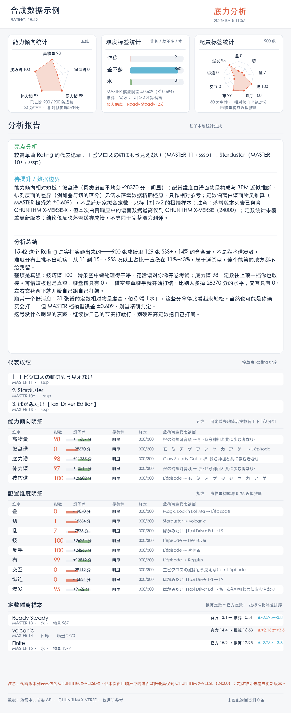

# QQ Bot（NoneBot2 + NapCat）

基于 NoneBot2 与 NapCat 的 QQ 机器人，主要面向中二节奏（CHUNITHM）和舞萌 DX 玩家。



## 功能

### 中二节奏 CHUNITHM

- `/底力分析`：生成包含能力倾向、配置维度、定数偏离和锐评总结的图片报告（别名 `/中二底力分析`、`/chunithm底力分析`）
- `/chu b50`、`/chu r50`、`/chu ap50`：Best 50 / Recent 50 / ALL PERFECT 50
- `/chu score <曲名|ID>`：单曲游玩情况；`/chu scorelist <条件>`：条件成绩列表
- `/chu minfo`（别名 `/chu 查歌`）：乐曲信息；`/chu random`（别名 `/chu 随机`）：随机乐曲
- 成绩查询支持 `@某人`，例如 `/chu b50 @小明`
- `/bind lxns <好友码>` 或 `/bind key <个人密钥>` 绑定落雪；绑定一次，查分与底力分析共用

### 舞萌 DX

- `/mai b50`、`/mai r50`、`/mai ap50`、`/mai n50`、`/mai pc50`
- `/mai score`、`/mai scorelist`、`/mai minfo`、`/mai random`
- `/trend`、`/今日舞萌`、`/舞萌状态`
- 支持落雪 / 水鱼数据源切换

### 群聊功能

- 机厅人数：`<机厅名>++`、`--`、`+N`、`-N`、`=N`、`几`，以及 `/机厅人数`
- otto 活字印刷：`otto活字印刷`、`otto鬼叫` 及多个别名
- 新成员进群自动欢迎，戳一戳机器人会随机回复
- `/help` 分类指令索引，`/hello` 连通性测试

## 快速开始

需要 Python 3.10+（建议 3.12）与 [uv](https://docs.astral.sh/uv/)。

```bash
cp .env.example .env
uv sync
uv run python bot.py
```

NapCat 通过 Docker 运行：

```bash
docker compose up -d napcat
```

浏览器打开 `http://127.0.0.1:6099/webui` 完成 QQ 扫码登录。`.env` 与 `data/` 已加入 `.gitignore`，令牌和用户数据不会被提交。

## 指令帮助

发送 `/help` 查看分类索引；`/help mai`、`/help chu`、`/help bind`、`/help group` 分别查看舞萌、中二、账号绑定和群功能的详细指令。

## 隐私

本仓库不包含真实用户数据；`docs/images/` 中的报告示例为合成数据。请勿在 Issue、PR 或日志中粘贴真实好友码、QQ 号或令牌。

## 许可

尚未选定开源许可证，默认保留所有权利；引用或分发前请先联系仓库作者。
